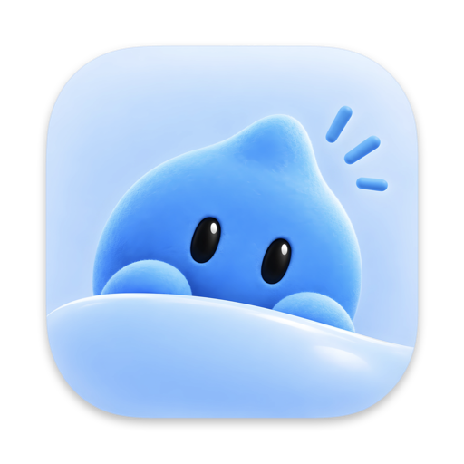
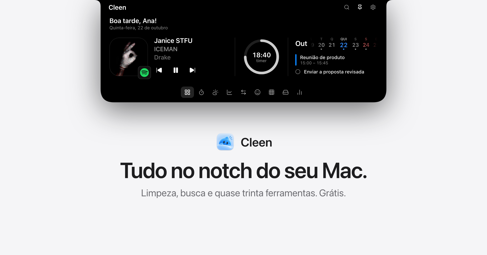

<p align="center">
  
</p>

<h1 align="center">Cleen</h1>

<p align="center">
  Limpeza e saúde do Mac, morando no notch.<br>
  Nativo em SwiftUI, sem dependências, nada sai do seu Mac.
</p>

<p align="center">
  <a href="https://github.com/matheuscarddoso/cleen/releases/latest"></a>
  
  
  
</p>

<p align="center">
  <a href="https://cleen.ocardoso.com"><b>cleen.ocardoso.com</b></a> ·
  <a href="https://github.com/matheuscarddoso/cleen/releases/latest"><b>Baixar</b></a> ·
  <a href="https://cleen.ocardoso.com/en">English</a>
</p>

<p align="center">
  
</p>

## Instalar

Precisa de um Mac com chip Apple e macOS 26 ou mais novo.

1. Baixe o `Cleen-<versão>.dmg` da [última versão](https://github.com/matheuscarddoso/cleen/releases/latest), abra e arraste o Cleen para Aplicativos.
2. Abra o Cleen. Ele não é notarizado pela Apple, então na primeira vez o macOS avisa
   que não pôde verificá-lo: clique em **OK**, vá em **Ajustes do Sistema ›
   Privacidade e Segurança**, role até o fim e clique em **Abrir Mesmo Assim**. Só na
   primeira vez.
3. O tour de boas-vindas pede as permissões, uma de cada vez, dizendo para que serve
   cada uma. Todas são opcionais.

O Cleen abre junto com o Mac (desliga em Ajustes) e se atualiza sozinho: a cada seis
horas procura uma versão nova nos releases deste repositório, confere o SHA-256 e a
assinatura, e troca o app. Para desinstalar, saia pelo ícone da barra de menus e mova
o Cleen para o Lixo.

## O notch

Passe o mouse no notch (ou ⌃⌥C) e o painel desce dele. Embaixo, uma dock com o
Início, a Shelf e uma grade com todas as ferramentas; qualquer uma pode ir para a
dock. Em telas sem notch o Cleen desenha um, e pode pôr um em cada monitor.

- **Início:** saudação, o que está tocando em qualquer app (com capa e controles), o
  dia no calendário, o Espelho e widgets que você arruma do seu jeito.
- **Ferramentas:** Calendário, Shelf, Área de transferência, Screenshots, Notas,
  Lembretes, Timer, Conversor, Emoji, Tempo, Atalhos, Ícones, Ações, Teleprompter,
  Perguntar, Mensagens, Agentes, Uso de IA e Sistema.
- **Busca** (⌥ Espaço): apps, arquivos, contas, conversões e comandos, à moda do
  Raycast.

### Fechado, ele mostra o que importa

| Quando | No notch |
|---|---|
| Música tocando | A capa e as barras do som |
| Download em andamento | Um anel com o progresso real e o tempo que falta; no fim, o arquivo |
| Chamada ou reunião | O tempo e a sua voz; aberto, microfone, câmera, tela e desligar |
| Ligação tocando | Quem liga, com atender e recusar |
| Mensagem nova | Quem mandou e o que disse; aberto, a resposta |
| Claude Code trabalhando | O passo atual; aberto, os passos, o arquivo, o comando, os limites |
| Volume e brilho | O nível no lugar do aviso do macOS |
| Bateria, fones, reunião, timer | Um aviso rápido de cada lado da câmera |

## Gravar

Uma gravação de tela no estilo do Screen Studio, saindo do próprio notch. Grave a
tela, uma janela, uma área ou um iPhone pelo cabo, com câmera, microfone e o som do
Mac. Ao parar, abre o editor:

- fundo (papéis de parede do macOS, gradientes, cores, sua imagem), desfoque, margem,
  cantos e sombra;
- zoom automático nos cliques, que segue o cursor e move o quadro inteiro, editável na
  linha do tempo;
- cursor redesenhado, nítido e suave, com a forma de cada momento e os cliques à
  mostra;
- cortes com a tesoura, velocidade por corte, recorte da imagem e layouts da câmera;
- exportação em MP4 (HEVC) até 4K e 60 fps.

## Limpeza do Mac

| Ferramenta | O que encontra | Para onde vai |
|---|---|---|
| Visão geral | Roda tudo de uma vez e limpa o que é seguro num clique | — |
| Limpeza | Caches, logs, Lixeira, instaladores, anexos do Mail, Xcode, npm/Composer/Homebrew, cache de navegadores, Docker, simuladores sem runtime | Caches: apagados de vez. Instaladores e backups: Lixo |
| Projetos | `node_modules`, `vendor`, `.next`, `target`, `.build`, `Pods`… de projetos parados | Apagados de vez (voltam com um install) |
| Arquivos grandes | Seus arquivos acima de N MB, com a data do último uso | Lixo |
| Duplicados | Cópias idênticas byte a byte (tamanho → 64 KB → SHA-256) | Lixo |
| Mapa do disco | O tamanho de cada pasta, navegável | Lixo |
| Desinstalar apps | O app e tudo o que ele espalhou em `~/Library` | Lixo |
| Restos de apps | Dados de apps que já foram apagados | Lixo |
| Inicialização | Launch agents e daemons, com a assinatura verificada | Desativar (reversível) ou Lixo |
| Manutenção | Liberar RAM, snapshots locais, DNS, Spotlight, Abrir Com, fontes, verificar o disco | — |

Toda remoção passa por `SafetyGuard` (`Sources/CleenKit/Core/SafetyGuard.swift`):
nunca toca nas pastas do sistema, nas pastas principais da conta (`~/Library`,
`~/Documents`…) nem em nada fora da pasta pessoal e de `/Applications`, e não deixa
um link simbólico levar até lá. O que você criou vai para o Lixo; só o que se recria
sozinho é apagado de vez. Tudo o que vai ser apagado aparece antes numa lista para
você confirmar.

## Privacidade

Nada é coletado nem enviado para o autor. Tudo é lido no próprio Mac:

- **Mensagens:** o banco do app Mensagens (`~/Library/Messages`, com o Acesso Total ao
  Disco) e os nomes dos Contatos. As respostas saem pelo próprio Mensagens.
- **Chamadas e ligações:** quem está usando o microfone, pelo Core Audio, e o aviso de
  ligação do macOS, pela Acessibilidade.
- **Downloads:** o progresso que os navegadores publicam para o Finder.
- **Agentes:** os arquivos de sessão que o Claude Code já grava no Mac.

A rede só entra em dois casos:

- **Uso de IA:** os limites do plano do Claude vêm de `api.anthropic.com`, com o login
  que o próprio Claude Code guardou nas Chaves do macOS (o macOS pergunta antes). O
  gasto e os limites do Codex são lidos dos arquivos locais.
- **Ícone do site tocando:** quando uma aba toca algo sem capa, o Cleen pede o ícone
  ao próprio site.

## Idiomas

O Cleen segue o idioma e a região do Mac: português ou inglês (os outros idiomas caem
no inglês), com datas, números e moeda no formato da região. O texto em português é a
chave de tradução; o inglês fica em `Support/Localization/en.lproj/Localizable.strings`.

## Desenvolvimento

```bash
swift build                     # compila
swift test                      # testes da CleenKit (Swift Testing)
./scripts/bundle.sh             # gera build/Cleen.app
./scripts/bundle.sh --install   # instala em /Applications e abre
./scripts/strings.sh            # o que falta traduzir
./scripts/dmg.sh                # gera build/Cleen.dmg
```

A versão vem da última tag (`v1.0.0` → 1.0.0). Para lançar:
`./scripts/release.sh 1.2.0 "o que mudou"` cria a tag, gera o DMG e publica o release
com o `appcast.json` que a atualização automática lê.

Para conferir telas: `--notch <aba>` abre o notch fixado numa aba, `--tools` abre a
grade, `--settings` abre os Ajustes, `--scan` já analisa, `--onboarding` repete o tour
e `--live <tipo>` mostra uma prévia (`download`, `message`, `call`, `volume`…).
`--editor <pasta>` abre uma gravação no editor.

`CleenKit` tem a lógica de disco, sistema e gravação, sem interface e testada contra
pastas temporárias. `Cleen` é o app (SwiftUI, isolamento padrão `MainActor`). O "tocando
agora" usa o Now Playing do sistema, que desde o macOS 15.4 só responde a binários da
Apple: `Support/NowPlaying` tem uma biblioteca pequena que o `/usr/bin/perl` carrega e
que transmite as mudanças como JSON (a técnica do projeto mediaremote-adapter).
